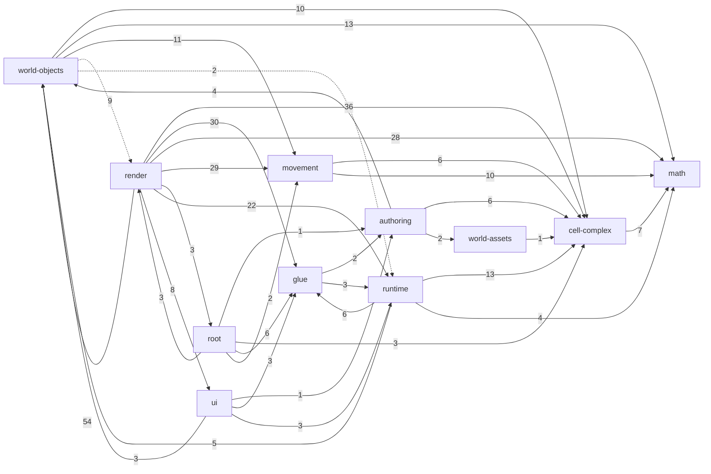

<!-- GENERATED by scripts/docs/generate-docs.mjs — do not edit by hand. Run `npm run docs:generate`. -->
<!-- Source of truth: the TypeScript modules under src/. This file is checked for freshness by `npm run docs:check` and the test suite. -->

# Architecture reference (generated)

This reference is produced from the source code. For the *meaning* of the modules — the mathematical model they implement — read [../MATHEMATICAL_MODEL.md](../MATHEMATICAL_MODEL.md) and [../ARCHITECTURE.md](../ARCHITECTURE.md). For every exported symbol see [API_REFERENCE.md](API_REFERENCE.md).

**156 modules, 43,342 lines** under `src/`.

## Layers

A module belongs to the layer named by its first path segment under `src/`. "May import" is the *intended* rule; violations are listed under [Layering debt](#layering-debt).

| Layer | Modules | Lines | May import | Purpose |
| --- | ---: | ---: | --- | --- |
| `math` | 6 | 547 | nothing | Vectors, rigid transforms, planes, polygons, tolerances. Pure; imports nothing. |
| `cell-complex` | 11 | 3,204 | `math` | Prism-cell specs, compilation, portal transforms, portal-path tables, static visibility culling. |
| `movement` | 7 | 956 | `math`, `cell-complex` | Player body, collision, movement and portal crossing in compiled cell complexes. |
| `world-assets` | 1 | 200 | `cell-complex`, `glue` | Floor-texture and asset descriptors. |
| `world-objects` | 11 | 8,603 | `math`, `cell-complex`, `movement`, `world-assets`, `glue` | Placeable runtime objects: registry, geodesic emitters, measurement tools, flags, creatures. |
| `authoring` | 5 | 671 | `math`, `cell-complex`, `examples`, `world-assets`, `world-objects` | World builder DSL, world-script compiler, validation and world catalog. |
| `runtime` | 10 | 2,637 | `math`, `cell-complex`, `movement`, `world-objects`, `authoring`, `ui`, `glue` | Runtime menu state, command dispatch, geometry session/worker and deformation families. |
| `ui` | 6 | 1,274 | `math`, `cell-complex`, `runtime`, `world-objects`, `authoring`, `glue` | Renderer-neutral palette, help, tooltip and input-intent definitions. |
| `glue` | 11 | 997 | `authoring`, `runtime`, `ui` | Launch options, debug settings, asset URLs, app configuration. |
| `render` | 86 | 24,029 | anything | Three.js / DOM / WebXR rendering and input adapters (the application shell). |
| `root` | 2 | 224 | anything | Entry point and application state. |

## Layer dependency graph

Edges are *actual* imports aggregated by layer; the label is the number of importing module pairs.

Dashed edges violate the intended layering (see below).

## Layering debt

These imports break the intended layering. They are frozen in `scripts/docs/layering-baseline.json`: `npm run docs:check` fails on any *new* violation, and fixing one should remove it from the baseline.

| Importing module | Imported module | Layer edge |
| --- | --- | --- |
| `world-objects/geodesicMarmot.ts` | `render/three/buildDecorationMesh.ts` | world-objects -> render |
| `world-objects/geodesicMarmot.ts` | `render/three/debugCollisionWireframes.ts` | world-objects -> render |
| `world-objects/geodesicMarmot.ts` | `render/three/preloadWorldAssets.ts` | world-objects -> render |
| `world-objects/geodesicMarmot.ts` | `render/three/runtimeDiagnostics.ts` | world-objects -> render |
| `world-objects/geodesicMarmot.ts` | `render/three/worldAxes.ts` | world-objects -> render |
| `world-objects/geodesicMarmot.ts` | `runtime/worldGeometryDeformations.ts` | world-objects -> runtime |
| `world-objects/simpleGeoCreature.ts` | `render/three/debugCollisionWireframes.ts` | world-objects -> render |
| `world-objects/simpleGeoCreature.ts` | `render/three/preloadWorldAssets.ts` | world-objects -> render |
| `world-objects/simpleGeoCreature.ts` | `render/three/runtimeDiagnostics.ts` | world-objects -> render |
| `world-objects/simpleGeoCreature.ts` | `render/three/worldAxes.ts` | world-objects -> render |
| `world-objects/simpleGeoCreature.ts` | `runtime/worldGeometryDeformations.ts` | world-objects -> runtime |

## Module index

### `math`

| Module | Lines | Summary | Imports |
| --- | ---: | --- | --- |
| `math/intersections.ts` | 63 | Segment-versus-plane intersection. | `math/planes`, `math/tolerances`, `math/vec3` |
| `math/planes.ts` | 65 | Oriented planes in 3D and point-versus-plane classification. | `math/tolerances`, `math/vec3` |
| `math/polygons.ts` | 136 | Planar polygons in the horizontal x/y plane: signed area, validation and point-in-polygon classification. | `math/tolerances` |
| `math/rigidTransform3.ts` | 168 | Rigid (orientation-preserving, distance-preserving) transforms of 3D space and 3x3 rotation matrices. | `math/vec3` |
| `math/tolerances.ts` | 14 | Shared absolute tolerance for geometric comparisons. | — |
| `math/vec3.ts` | 101 | Immutable 3D vector type and the small set of free functions used throughout the engine. | `math/tolerances` |

### `cell-complex`

| Module | Lines | Summary | Imports |
| --- | ---: | --- | --- |
| `cell-complex/compileCellComplex.ts` | 60 | Top-level compiler from an authored cell-complex spec to the runtime geometry used by movement and rendering. | `cell-complex/compilePortalTransforms`, `cell-complex/prismCells`, `cell-complex/specs`, `cell-complex/validateCellComplexSpec` |
| `cell-complex/compilePortalTransforms.ts` | 168 | Derives the rigid gluing map of every portal from the geometry of the two sides it joins. | `cell-complex/prismCells`, `cell-complex/specs`, `math/rigidTransform3`, `math/vec3` |
| `cell-complex/describeGeometry.ts` | 48 | Human-readable text summary of an authored cell-complex spec, for logging and debugging. | `cell-complex/specs` |
| `cell-complex/forbiddenZones.ts` | 47 | Constants and types for forbidden zones: vertical cylinders at cell base vertices where portal sides meet. | — |
| `cell-complex/portalPathDebug.ts` | 235 | Debugging helpers that explain what happened to a portal path during table construction and static culling. | `cell-complex/compileCellComplex`, `cell-complex/portalPaths`, `cell-complex/staticPortalPathCull` |
| `cell-complex/portalPaths.ts` | 254 | Portal-path tables: for each root cell, every portal word (sequence of portals crossed) up to a depth limit, with the rigid transforms that place the destination cell in the root cell's frame. | `cell-complex/compileCellComplex`, `cell-complex/specs`, `math/rigidTransform3` |
| `cell-complex/prismBase.ts` | 107 | Type-level and runtime validation of the base polygon of a prism cell. | `math/tolerances` |
| `cell-complex/prismCells.ts` | 185 | Compiled runtime representation of a single prism cell and its sides. | `cell-complex/forbiddenZones`, `cell-complex/specs` |
| `cell-complex/specs.ts` | 235 | Authoring-level data model for a cell complex: the plain-data spec that world files produce and the compiler consumes. | `math/rigidTransform3` |
| `cell-complex/staticPortalPathCull.ts` | 1640 | Static, view-independent culling of portal-path tables: discards portal words through which no sight line from the root cell could reach the destination cell. | `cell-complex/compileCellComplex`, `cell-complex/forbiddenZones`, `cell-complex/portalPaths`, `cell-complex/prismCells`, `cell-complex/specs`, `math/rigidTransform3`, `math/vec3` |
| `cell-complex/validateCellComplexSpec.ts` | 225 | Cell-complex spec validator: structural checks on a CellComplexSpec before it is compiled (authoring spec -> compiled complex stage). | `cell-complex/specs` |

### `movement`

| Module | Lines | Summary | Imports |
| --- | ---: | --- | --- |
| `movement/collision.ts` | 350 | Collision tests of a dynamic object against its current cell, and helpers for side-relative geometry. | `cell-complex/forbiddenZones`, `cell-complex/prismCells`, `math/rigidTransform3`, `math/vec3`, `movement/dynamicObject` |
| `movement/dynamicObject.ts` | 49 | State of a movable object (player body, creature, geodesic emitter) inside a compiled cell complex. | `math/rigidTransform3`, `math/vec3` |
| `movement/moveDynamicObject.ts` | 284 | Advances a dynamic object by a displacement inside the glued cell complex, handling portal crossing, collision and wall sliding. | `cell-complex/compileCellComplex`, `cell-complex/prismCells`, `math/rigidTransform3`, `math/vec3`, `movement/collision`, `movement/dynamicObject`, `movement/portalCrossing` |
| `movement/movePlayer.ts` | 144 | Player locomotion: applies look and move input to a player pose, with collision and portal crossing when a world is given. | `cell-complex/compileCellComplex`, `math/vec3`, `movement/collision`, `movement/dynamicObject`, `movement/moveDynamicObject`, `movement/playerBody`, `movement/playerPose` |
| `movement/playerBody.ts` | 35 | Physical dimensions of the player's body used for collision and eye placement. | — |
| `movement/playerPose.ts` | 62 | Player pose (cell, position, yaw, pitch) and its conversion to and from the generic dynamic-object representation. | `math/rigidTransform3`, `math/vec3`, `movement/dynamicObject` |
| `movement/portalCrossing.ts` | 32 | Re-expressing an object's or player's pose in the target cell's frame when it passes through a portal. | `cell-complex/specs`, `math/rigidTransform3`, `movement/dynamicObject`, `movement/playerPose` |

### `world-assets`

| Module | Lines | Summary | Imports |
| --- | ---: | --- | --- |
| `world-assets/floorTextures.ts` | 200 | Floor texture library: the named floor appearances world scripts can use, via the `floorTexture` helper. | `cell-complex/specs` |

### `world-objects`

| Module | Lines | Summary | Imports |
| --- | ---: | --- | --- |
| `world-objects/geodesicCannon.ts` | 5884 | Geodesic emitters ("cannons"), geodesic intervals and curve shortening on a glued cell complex. | `cell-complex/compileCellComplex`, `math/rigidTransform3`, `math/vec3`, `movement/collision`, `movement/dynamicObject`, `movement/moveDynamicObject`, `world-objects/runtimeObjectRegistry` |
| `world-objects/geodesicMarmot.ts` | 257 | Geodesic marmot: an autonomous creature that walks in a straight line (a locally straight geodesic) through the cell complex, crossing portals. | `cell-complex/compileCellComplex`, `cell-complex/specs`, `math/rigidTransform3`, `math/vec3`, `movement/dynamicObject`, `movement/moveDynamicObject`, `render/three/buildDecorationMesh`, `render/three/debugCollisionWireframes`, `render/three/preloadWorldAssets`, `render/three/runtimeDiagnostics`, `render/three/worldAxes`, `runtime/worldGeometryDeformations`, `world-objects/runtimeObjectRegistry` |
| `world-objects/helpHubCopy.ts` | 10 | Help-hub copy shared by the authoring layer (world tutorial text) and the ui layer (palette and help hubs), so both show identical wording. | — |
| `world-objects/library.ts` | 396 | World object library: the catalogue of named, ready-to-place objects available to world scripts (tree, house, bench, geo_mouse, geodesic_marmot, ...). | `cell-complex/specs`, `world-objects/geodesicMarmot`, `world-objects/objectMetadata`, `world-objects/simpleGeoCreature`, `world-objects/staticAssets` |
| `world-objects/measureLengthTool.ts` | 226 | Measured-length tool: persistent "geodesic length = N m" labels attached to a geodesic. | `math/rigidTransform3`, `math/vec3`, `world-objects/geodesicCannon`, `world-objects/runtimeObjectRegistry` |
| `world-objects/objectMetadata.ts` | 8 | Collision class name ("user") of the player's avatar; objects listing it in `do_not_collide_with` do not block the player. | — |
| `world-objects/placedFlags.ts` | 295 | Placed flags (signs): player-placed wooden signs carrying a short text label. | `cell-complex/compileCellComplex`, `math/rigidTransform3`, `math/vec3`, `movement/collision`, `movement/dynamicObject`, `world-objects/runtimeObjectRegistry` |
| `world-objects/protractorTool.ts` | 557 | Protractor tool: persistent angle measurements between two geodesic directions at a common vertex. | `math/rigidTransform3`, `math/vec3`, `world-objects/geodesicCannon`, `world-objects/runtimeObjectRegistry` |
| `world-objects/runtimeObjectRegistry.ts` | 339 | Runtime object registry: the per-cell, id-indexed store of every live (non-terrain) object in the world. | `cell-complex/specs`, `math/rigidTransform3`, `movement/dynamicObject`, `world-objects/geodesicCannon`, `world-objects/measureLengthTool`, `world-objects/objectMetadata`, `world-objects/placedFlags`, `world-objects/protractorTool` |
| `world-objects/simpleGeoCreature.ts` | 532 | Simple geodesic creatures: the mouse and the butterfly, autonomous walkers that follow straight lines (geodesics) through the cell complex. | `cell-complex/compileCellComplex`, `cell-complex/prismCells`, `cell-complex/specs`, `math/rigidTransform3`, `math/vec3`, `movement/collision`, `movement/dynamicObject`, `movement/moveDynamicObject`, `render/three/debugCollisionWireframes`, `render/three/preloadWorldAssets`, `render/three/runtimeDiagnostics`, `render/three/worldAxes`, `runtime/worldGeometryDeformations`, `world-objects/runtimeObjectRegistry`, `world-objects/staticAssets` |
| `world-objects/staticAssets.ts` | 99 | Static asset authoring helper: converts author-facing parameters for a glTF decoration into an AssetObjectSpec. | `cell-complex/specs` |

### `authoring`

| Module | Lines | Summary | Imports |
| --- | ---: | --- | --- |
| `authoring/compileWorldScript.ts` | 105 | World-script compiler: runs a world script's JavaScript text against a sandboxed name scope and returns the resulting CellComplexSpec (authoring script -> CellComplexSpec stage of the pipeline). | `authoring/worldBuilder`, `cell-complex/specs`, `world-assets/floorTextures`, `world-objects/library` |
| `authoring/exampleWorlds.ts` | 62 | Bundled example worlds: compiles the .world.js scripts in src/examples/ (imported as raw text) into CellComplexSpec constants at module load. | `authoring/compileWorldScript`, `cell-complex/specs` |
| `authoring/validateAuthoringSpec.ts` | 11 | Compatibility re-export of the spec validator, which now lives in cell-complex/validateCellComplexSpec so the compiler does not import the authoring layer. | `cell-complex/validateCellComplexSpec` |
| `authoring/worldBuilder.ts` | 387 | World builder: the imperative API behind the world-script DSL that assembles a CellComplexSpec. | `cell-complex/prismBase`, `cell-complex/specs`, `world-assets/floorTextures`, `world-objects/helpHubCopy`, `world-objects/library`, `world-objects/staticAssets` |
| `authoring/worldCatalog.ts` | 106 | World catalog: the list of selectable bundled worlds and the lookup that turns a world id (or a file-like name) into a CellComplexSpec. | `authoring/exampleWorlds`, `cell-complex/specs` |

### `runtime`

| Module | Lines | Summary | Imports |
| --- | ---: | --- | --- |
| `runtime/appCommandDispatcher.ts` | 61 | Routes renderer-neutral RuntimeCommand values (from the desktop menu and the VR palette alike) to the host callbacks that actually reload, change world, go home or toggle the debug overlay. | `runtime/runtimeCommands` |
| `runtime/deformations/torusSkewDeformation.ts` | 389 | Deformation family for the one-cell torus world: the cell "torus-room" is a prism whose footprint is a parallelogram with edge vectors u = (w, 0) and v = (a, b), and opposite sides glued by translation (side-0 with side… | `cell-complex/compileCellComplex`, `cell-complex/specs`, `math/vec3`, `runtime/worldGeometryDeformations` |
| `runtime/runtimeCommands.ts` | 13 | Defines RuntimeCommand, the closed discriminated union of application-level actions that menus and palettes can request without knowing about the renderer. | — |
| `runtime/runtimeMenuState.ts` | 733 | Renderer-neutral state machine for the in-game menu, shared by the desktop overlay and the VR palette. | `cell-complex/specs`, `glue/appConfig`, `glue/debugLevels`, `glue/debugOptions`, `glue/debugSettings`, `glue/portalPanelMode`, `glue/vrComfortOptions`, `world-objects/placedFlags` |
| `runtime/worldGeometryComputedObjects.ts` | 329 | Policy for derived objects (geodesics, measured geodesic lengths, protractor angles, geodesic intersection markers) when a newly deformed world geometry is committed. | `cell-complex/compileCellComplex`, `math/vec3`, `world-objects/geodesicCannon`, `world-objects/measureLengthTool`, `world-objects/protractorTool`, `world-objects/runtimeObjectRegistry` |
| `runtime/worldGeometryDeformationFamilies.ts` | 132 | Registry of WorldDeformationFamily implementations keyed by state kind, plus helpers to apply a state to a spec and to choose the initial state for a world. | `cell-complex/specs`, `runtime/deformations/torusSkewDeformation`, `runtime/worldGeometryDeformations` |
| `runtime/worldGeometryDeformations.ts` | 440 | Family-independent vocabulary and helpers for live deformation of a cell complex while preserving its combinatorics (cells, sides, portals and their pairing). | `cell-complex/compileCellComplex`, `cell-complex/specs`, `math/rigidTransform3`, `math/vec3`, `runtime/deformations/torusSkewDeformation` |
| `runtime/worldGeometrySession.ts` | 298 | Owns the live deformation of the cell complex during play: it tracks the committed deformation state (current), the requested target, and at most one in-flight background build. | `cell-complex/compileCellComplex`, `cell-complex/specs`, `cell-complex/staticPortalPathCull`, `runtime/worldGeometryDeformationFamilies`, `runtime/worldGeometryDeformations`, `runtime/worldGeometryWorkerClient` |
| `runtime/worldGeometryWorker.ts` | 115 | Pure build step (and Web Worker entry) that turns a base CellComplexSpec plus a deformation state into a fully compiled, topology-validated world with its static portal-path culling tables. | `cell-complex/compileCellComplex`, `cell-complex/specs`, `cell-complex/staticPortalPathCull`, `runtime/worldGeometryDeformationFamilies`, `runtime/worldGeometryDeformations` |
| `runtime/worldGeometryWorkerClient.ts` | 127 | Abstracts where world-geometry snapshots are built: a dedicated module Web Worker, or an inline fallback on the main thread. | `runtime/worldGeometryWorker` |

### `ui`

| Module | Lines | Summary | Imports |
| --- | ---: | --- | --- |
| `ui/helpLensDefinition.ts` | 171 | Renderer-neutral definition of the contextual "help lens" panel shown on desktop and in VR: a title, a body sentence and rows pairing an input glyph with an action label. | `runtime/runtimeMenuState`, `ui/inputIntents`, `ui/inputModeText`, `ui/worldInteractionDefinition` |
| `ui/inputIntents.ts` | 101 | Maps abstract input intents (move, primary action, context menu, help, ...) to the label and optional icon that show the player which physical control performs them in desktop or XR mode. | `glue/assetUrls` |
| `ui/inputModeText.ts` | 49 | Shared text rewriter that turns device-neutral help sentences into desktop or XR wording. | `ui/inputIntents` |
| `ui/paletteDefinition.ts` | 629 | Renderer-neutral definition of the tool/settings palette: createPaletteDefinition turns a RuntimeMenuState plus the app config and input mode into a PaletteDefinition, a plain-data description (header actions plus one p… | `authoring/worldCatalog`, `glue/appConfig`, `glue/portalPanelMode`, `runtime/runtimeMenuState`, `ui/inputIntents`, `ui/inputModeText`, `world-objects/helpHubCopy`, `world-objects/placedFlags` |
| `ui/paletteTooltips.ts` | 96 | Resolves the tooltip text for palette items from their string item ids. | — |
| `ui/worldInteractionDefinition.ts` | 228 | Renderer-neutral description of what the player can do with the world object they are focusing: its title and a prioritized list of actions, each bound to an abstract input intent. | `runtime/runtimeMenuState`, `ui/inputIntents`, `world-objects/runtimeObjectRegistry` |

### `glue`

| Module | Lines | Summary | Imports |
| --- | ---: | --- | --- |
| `glue/appConfig.ts` | 290 | Loads and normalizes the app configuration: a per-deployment JavaScript file (<name>.config.js in the public folder, chosen by the ?config= URL parameter) that sets the starting world, which menu sections and tools are … | `authoring/worldCatalog`, `glue/assetUrls`, `glue/debugLevels`, `glue/debugOptions`, `glue/portalPanelMode`, `runtime/runtimeMenuState` |
| `glue/assetUrls.ts` | 19 | Builds URLs for files served from the Vite public folder, honoring the deployment base path (import.meta.env.BASE_URL) so the app works when hosted under a sub-path. | — |
| `glue/debugLevels.ts` | 49 | Defines the debug levels (off, basic, verbose) as a single constant table that is the source of truth for the DebugLevelId type, the settings UI and URL parsing. | — |
| `glue/debugOptions.ts` | 103 | Defines the individual debug options (diagnostics logging, portal path/cull inspection, overlays, wireframes, hitbox displays) as a constant table that is the source of truth for the DebugOptionId type. | — |
| `glue/debugSettings.ts` | 46 | Value types describing a complete debug configuration (level, portal panel mode and enabled options) and a predicate telling whether a change to it can be applied to a running world without a reload. | `glue/debugLevels`, `glue/debugOptions`, `glue/portalPanelMode` |
| `glue/launchOptionsUrl.ts` | 93 | Converts between launch options and URL query parameters: strips them from the visible address after startup (so reloads and shared links are clean) and builds a shareable URL that reproduces the current options. | `glue/appConfig`, `glue/debugOptions`, `glue/readLaunchOptions`, `glue/uiOptions`, `runtime/runtimeMenuState` |
| `glue/loadingStatus.ts` | 89 | Minimal DOM loading screen shown while a world loads: a log of phase lines with the latest highlighted, plus an error state. | — |
| `glue/portalPanelMode.ts` | 57 | Defines the portal panel display modes (none, panel, panel-with-text, text-only) as a constant table and the predicates deciding which portal visuals a mode draws. | — |
| `glue/readLaunchOptions.ts` | 156 | Parses the page URL's query string into a LaunchOptions record, with precedence: explicit URL parameter, then the app config's value, then the built-in default. | `authoring/worldCatalog`, `glue/appConfig`, `glue/debugLevels`, `glue/debugOptions`, `glue/portalPanelMode`, `glue/uiOptions`, `glue/vrComfortOptions`, `runtime/runtimeMenuState` |
| `glue/uiOptions.ts` | 51 | Defines the optional UI widgets that launch options can show (WorldSelector, DebugButton) as a constant table that is the source of truth for the UiOptionId type, with canonical parse and serialize helpers for the comma… | — |
| `glue/vrComfortOptions.ts` | 44 | Pure (Three-free) VR comfort settings: the `VrComfortOptions` record and its defaults. | — |

### `render`

| Module | Lines | Summary | Imports |
| --- | ---: | --- | --- |
| `render/dom/desktopFlagEditor.ts` | 167 | Modal DOM editor for a placed flag (sign): message text, text color, delete, and close. | `world-objects/placedFlags` |
| `render/dom/desktopToolIndicator.ts` | 199 | Small DOM badge showing the currently selected desktop tool (icon, name, and a selection prompt) near the HUD. | `glue/assetUrls`, `runtime/runtimeMenuState`, `world-objects/placedFlags` |
| `render/dom/floatingObjectTooltip.ts` | 133 | Floating tooltip DOM element that follows a screen position, used for object focus hints on desktop. | `glue/assetUrls` |
| `render/three/aimCrossMarker.ts` | 127 | Red cross decal drawn on the surface point that the aim ray currently hits. | `render/three/aimTarget`, `render/three/worldAxes` |
| `render/three/aimInteraction.ts` | 316 | Aim-ray resolution for both input modes: the desktop camera center ray and the right (or first) XR controller ray. | `cell-complex/compileCellComplex`, `glue/debugLevels`, `render/three/aimTarget`, `render/three/appDebugHelpers`, `render/three/geodesicCannonTools`, `render/three/renderCameraClip`, `render/three/rootAimRay`, `render/three/visiblePortalPaths`, `render/three/xrPlayerRig`, `runtime/runtimeMenuState`, `ui/worldInteractionDefinition`, `world-objects/geodesicCannon`, `world-objects/runtimeObjectRegistry` |
| `render/three/aimTarget.ts` | 1165 | Crosshair aim picking: finds what the camera's centre ray hits, across portals. | `cell-complex/compileCellComplex`, `cell-complex/prismCells`, `math/vec3`, `movement/collision`, `render/three/visiblePortalPaths`, `render/three/worldAxes`, `world-objects/geodesicCannon`, `world-objects/protractorTool`, `world-objects/runtimeObjectRegistry` |
| `render/three/appDebugHelpers.ts` | 605 | Browser-console debug surface for the app: window-level helper installation, the shapes of the JSON dumps they return, and small number/portal-word formatters. | `cell-complex/portalPathDebug`, `cell-complex/portalPaths`, `cell-complex/staticPortalPathCull`, `math/vec3`, `movement/playerBody`, `movement/playerPose`, `render/three/geodesicCreatureDebug`, `render/three/renderPortalInstances`, `render/three/renderQuality`, `render/three/renderState`, `render/three/visiblePortalPaths`, `render/three/worldAxes`, `runtime/runtimeMenuState`, `runtime/worldGeometrySession`, `world-objects/geodesicCannon`, `world-objects/runtimeObjectRegistry` |
| `render/three/appDebugLogging.ts` | 112 | Console guides printed when debug options are enabled. | `cell-complex/portalPaths`, `cell-complex/staticPortalPathCull`, `glue/debugLevels`, `glue/debugOptions` |
| `render/three/buildCellMesh.ts` | 361 | Builds the Three.js geometry of one prism cell in the cell's own local frame (which the portal pipeline later places). | `cell-complex/prismCells`, `glue/debugLevels`, `glue/portalPanelMode`, `render/three/buildDecorationMesh`, `render/three/buildPortalMesh`, `render/three/debugCollisionWireframes`, `render/three/preloadWorldAssets`, `render/three/sceneColors`, `world-objects/geodesicMarmot`, `world-objects/simpleGeoCreature` |
| `render/three/buildDecorationMesh.ts` | 187 | Builds the Three.js node for a static decoration (asset object) declared in a cell spec. | `cell-complex/specs`, `render/three/preloadWorldAssets`, `render/three/runtimeDiagnostics`, `render/three/worldAxes` |
| `render/three/buildPortalMesh.ts` | 75 | Builds the visible wall panel of a portal side (the textured "doorway" surface) in a cell's local frame. | `render/three/portalWallTexture`, `render/three/preloadWorldAssets` |
| `render/three/canvasDrawing.ts` | 28 | Canvas 2D drawing helpers used to build text-label textures. | — |
| `render/three/carriedGeodesicCannon.ts` | 165 | Pure placement, glow, and naming helpers for carrying and aiming geodesic emitters. | `math/vec3`, `render/three/rootAimRay`, `render/three/worldAxes`, `world-objects/geodesicCannon`, `world-objects/runtimeObjectRegistry` |
| `render/three/cellRenderArchetypes.ts` | 311 | Builds the instanced-mesh archetypes for the static geometry of every cell, one archetype per drawable mesh part. | `cell-complex/compileCellComplex`, `cell-complex/prismCells`, `cell-complex/staticPortalPathCull`, `glue/debugLevels`, `glue/portalPanelMode`, `render/three/buildCellMesh`, `render/three/portalClipMaterial`, `render/three/preloadWorldAssets`, `render/three/runtimeSceneUtils` |
| `render/three/createThreeApp.ts` | 3556 | Application shell: builds the Three.js scene, owns the shared mutable state (player pose, menu state, visible-portal results, tool state) and runs the frame loop. | `appState`, `cell-complex/specs`, `cell-complex/staticPortalPathCull`, `glue/appConfig`, `glue/debugLevels`, `glue/debugOptions`, `glue/debugSettings`, `glue/portalPanelMode`, `glue/readLaunchOptions`, `math/rigidTransform3`, `movement/collision`, `movement/dynamicObject`, `movement/movePlayer`, `movement/playerBody`, `movement/playerPose`, `render/dom/desktopFlagEditor`, `render/dom/desktopToolIndicator`, `render/dom/floatingObjectTooltip`, `render/three/aimCrossMarker`, `render/three/aimInteraction`, `render/three/appDebugHelpers`, `render/three/appDebugLogging`, `render/three/carriedGeodesicCannon`, `render/three/cellRenderArchetypes`, `render/three/debugOverlay`, `render/three/debugVisualization`, `render/three/desktopControls`, `render/three/desktopScenePaletteInput`, `render/three/desktopScenePalettePlacement`, `render/three/frameDiagnostics`, `render/three/geodesicCannonRenderer`, `render/three/geodesicCannonTools`, `render/three/geodesicCarryPortalTransition`, `render/three/geodesicDebugDumps`, `render/three/geodesicEmitterLabelController`, `render/three/geometryComputerMenu`, `render/three/helpLensRenderer`, `render/three/measureLengthRenderer`, `render/three/placedFlagRenderer`, `render/three/playerRoverModel`, `render/three/portalClipData`, `render/three/portalClipMaterial`, `render/three/portalClipPolygonOverlay`, `render/three/portalDebugRuntime`, `render/three/portalEyeFrameTransforms`, `render/three/portalInstanceDebug`, `render/three/preloadWorldAssets`, `render/three/prerenderCells`, `render/three/protractorAngleRenderer`, `render/three/protractorToolFeedback`, `render/three/renderCameraClip`, `render/three/renderPortalInstances`, `render/three/renderQuality`, `render/three/renderState`, `render/three/rootAimRay`, `render/three/runtimeDiagnostics`, `render/three/runtimeObjectGhostRecords`, `render/three/runtimeObjectRenderArchetypes`, `render/three/runtimeObjectRenderRecords`, `render/three/runtimeSceneUtils`, `render/three/sceneColors`, `render/three/sceneLighting`, `render/three/scenePaletteController`, `render/three/toolObjectRuntimes`, `render/three/underCellFloor`, `render/three/visiblePortalPaths`, `render/three/vrComfort`, `render/three/vrPalettePlacement`, `render/three/worldAxes`, `render/three/xrControllerHandModels`, `render/three/xrControls`, `render/three/xrEntryUi`, `render/three/xrObjectTooltipController`, `render/three/xrPlayerRig`, `render/three/xrPortalEye`, `render/three/xrScenePaletteInput`, `render/three/xrSessionRestart`, `render/three/xrSessionState`, `runtime/appCommandDispatcher`, `runtime/runtimeCommands`, `runtime/runtimeMenuState`, `runtime/worldGeometryComputedObjects`, `runtime/worldGeometryDeformationFamilies`, `runtime/worldGeometryDeformations`, `runtime/worldGeometrySession`, `ui/helpLensDefinition`, `ui/paletteDefinition`, `world-objects/geodesicCannon`, `world-objects/geodesicMarmot`, `world-objects/measureLengthTool`, `world-objects/placedFlags`, `world-objects/protractorTool`, `world-objects/runtimeObjectRegistry`, `world-objects/simpleGeoCreature` |
| `render/three/debugCollisionWireframes.ts` | 202 | Debug wireframes for collision volumes: forbidden-zone (singularity) columns and object collision cylinders. | `cell-complex/forbiddenZones`, `movement/collision`, `movement/dynamicObject`, `render/three/worldAxes` |
| `render/three/debugHitboxMeshes.ts` | 327 | Debug meshes that visualize selectable hitboxes (translucent solids) and aim collision outlines (wireframes) of runtime world objects. | `movement/collision`, `render/three/aimTarget`, `render/three/worldAxes`, `world-objects/protractorTool`, `world-objects/runtimeObjectRegistry` |
| `render/three/debugOverlay.ts` | 203 | Text-only HUD overlay (a div with class debug-overlay) listing frame timing, WebGL, portal-visibility, location and geometry diagnostics. | `render/three/renderState`, `runtime/worldGeometrySession` |
| `render/three/debugVisualization.ts` | 160 | Debug visuals attached to cell roots: object collision wireframes, selectable-hitbox meshes, and aim-collision outlines. | `cell-complex/compileCellComplex`, `glue/debugLevels`, `glue/debugOptions`, `render/three/debugHitboxMeshes`, `render/three/runtimeSceneUtils`, `render/three/staticObjectCollisionWireframes`, `world-objects/geodesicMarmot`, `world-objects/runtimeObjectRegistry`, `world-objects/simpleGeoCreature` |
| `render/three/desktopControls.ts` | 371 | Desktop keyboard and pointer-lock mouse input, collected into one DesktopInputFrame per rendered frame. | `math/vec3`, `render/three/renderState` |
| `render/three/desktopScenePaletteInput.ts` | 143 | Desktop input path for the in-scene palette: turns mouse motion and button state into a single virtual pointer aimed at the palette. | `render/three/desktopControls`, `render/three/scenePaletteInput`, `render/three/scenePaletteLayout` |
| `render/three/desktopScenePalettePlacement.ts` | 53 | Desktop placement of the in-scene palette: a panel floating 1.05 m in front of the camera, facing it. | `render/three/scenePaletteInput` |
| `render/three/frameDiagnostics.ts` | 68 | Frame-timing smoothing, WebGL render-info capture, and the initial XR debug state used by the debug overlay. | `movement/playerPose`, `render/three/renderQuality`, `render/three/renderState`, `render/three/xrSessionState` |
| `render/three/geodesicCannonAimTarget.ts` | 35 | Computes the yaw a geodesic cannon should adopt to face a target point. | `math/vec3` |
| `render/three/geodesicCannonRenderer.ts` | 361 | Render sources and per-frame render records for geodesic cannons, geodesic segments and geodesic intersections. | `math/rigidTransform3`, `render/three/preloadWorldAssets`, `render/three/runtimeObjectRenderRecords`, `render/three/worldAxes`, `world-objects/geodesicCannon` |
| `render/three/geodesicCannonTools.ts` | 1309 | Geodesic emitter (cannon) tools: place, rotate, aim, carry, tie-and-detach, and delete geodesics. | `cell-complex/compileCellComplex`, `glue/debugLevels`, `math/rigidTransform3`, `math/vec3`, `movement/collision`, `movement/moveDynamicObject`, `movement/playerPose`, `render/three/aimInteraction`, `render/three/aimTarget`, `render/three/appDebugHelpers`, `render/three/carriedGeodesicCannon`, `render/three/desktopControls`, `render/three/geodesicCannonAimTarget`, `render/three/geodesicCarryPortalTransition`, `render/three/rootAimRay`, `render/three/runtimeSceneUtils`, `render/three/worldAxes`, `runtime/runtimeMenuState`, `world-objects/geodesicCannon`, `world-objects/runtimeObjectRegistry` |
| `render/three/geodesicCarryPortalTransition.ts` | 65 | Derives the portal-crossing record a carried geodesic cannon needs from a player move result. | `cell-complex/compileCellComplex`, `movement/movePlayer`, `world-objects/geodesicCannon` |
| `render/three/geodesicCreatureDebug.ts` | 257 | Consistency checker for geodesic creatures (marmot, mouse, butterfly) that produces a debug dump. | `cell-complex/compileCellComplex`, `movement/collision`, `render/three/worldAxes`, `world-objects/geodesicMarmot`, `world-objects/runtimeObjectRegistry`, `world-objects/simpleGeoCreature` |
| `render/three/geodesicDebugDumps.ts` | 410 | Console debug dumps for geodesics and geodesic creatures, plus the periodic creature consistency check. | `cell-complex/compileCellComplex`, `glue/debugLevels`, `math/vec3`, `render/three/aimTarget`, `render/three/appDebugHelpers`, `render/three/carriedGeodesicCannon`, `render/three/geodesicCreatureDebug`, `runtime/runtimeMenuState`, `world-objects/geodesicCannon`, `world-objects/geodesicMarmot`, `world-objects/runtimeObjectRegistry`, `world-objects/simpleGeoCreature` |
| `render/three/geodesicEmitterLabelController.ts` | 127 | Keeps the floating geodesic-name labels next to nearby emitters in sync with the registry. | `movement/playerPose`, `render/three/geodesicEmitterLabels`, `render/three/runtimeSceneUtils`, `world-objects/geodesicCannon`, `world-objects/runtimeObjectRegistry` |
| `render/three/geodesicEmitterLabels.ts` | 93 | Floating text labels shown next to geodesic emitters. | `math/rigidTransform3`, `render/three/canvasDrawing`, `render/three/geodesicCannonRenderer`, `render/three/worldAxes`, `world-objects/runtimeObjectRegistry` |
| `render/three/geometryComputerMenu.ts` | 156 | Menu logic for the in-world geometry computer, which edits the torus-skew parameters of the world and starts the deformation. | `render/three/runtimeSceneUtils`, `runtime/runtimeMenuState`, `runtime/worldGeometrySession` |
| `render/three/helpLensRenderer.ts` | 301 | Help panel ("help lens") renderer: shows the current contextual help definition either as a DOM panel (desktop) or as a floating textured plane in front of the camera (XR). | `glue/assetUrls`, `render/three/canvasDrawing`, `ui/helpLensDefinition` |
| `render/three/measureLengthRenderer.ts` | 106 | Renderer for measured-geodesic-length labels placed in the world. | `render/three/runtimeSceneUtils`, `render/three/worldAxes`, `render/three/worldResultBadge`, `world-objects/measureLengthTool` |
| `render/three/pathTraceOverlay.ts` | 173 | Debug overlay that draws a traced portal path through the cells it crosses. | `appState`, `cell-complex/portalPaths`, `cell-complex/prismCells`, `math/rigidTransform3`, `render/three/runtimeSceneUtils`, `render/three/worldAxes` |
| `render/three/placedFlagRenderer.ts` | 378 | Renderer for player-placed text signs ("flags"): a glTF sign model with the user's message drawn on both faces. | `render/three/preloadWorldAssets`, `render/three/worldAxes`, `world-objects/placedFlags` |
| `render/three/playerRoverModel.ts` | 110 | Render model for the player's own rover avatar. | `cell-complex/compileCellComplex`, `math/rigidTransform3`, `movement/dynamicObject`, `movement/playerPose`, `render/three/preloadWorldAssets`, `render/three/runtimeObjectRenderRecords`, `render/three/worldAxes`, `world-objects/library` |
| `render/three/portalClipData.ts` | 190 | CPU side of the per-path clip-polygon texture that lets the GPU clip each portal instance to its visible aperture. | `render/three/visiblePortalPaths` |
| `render/three/portalClipMaterial.ts` | 381 | Patches Three.js materials so instanced portal geometry is clipped, per fragment, to its path's convex NDC polygon. | `render/three/portalClipData` |
| `render/three/portalClipPolygonOverlay.ts` | 119 | Debug overlay that draws each visible portal path's NDC clip polygon as a labelled SVG polygon over the canvas. | `render/three/visiblePortalPaths` |
| `render/three/portalDebugRuntime.ts` | 476 | Portal-path debug runtime: installs window.noneuclidPortalDebug, manages cell-path overlays and clip-polygon overlays, and feeds the on-screen debug overlay each frame. | `cell-complex/compileCellComplex`, `cell-complex/portalPathDebug`, `cell-complex/staticPortalPathCull`, `glue/debugLevels`, `glue/debugOptions`, `math/rigidTransform3`, `math/vec3`, `movement/playerPose`, `render/three/appDebugHelpers`, `render/three/appDebugLogging`, `render/three/debugOverlay`, `render/three/pathTraceOverlay`, `render/three/portalClipPolygonOverlay`, `render/three/portalInstanceDebug`, `render/three/renderPortalInstances`, `render/three/renderQuality`, `render/three/renderState`, `render/three/runtimeSceneUtils`, `render/three/visiblePortalPaths`, `render/three/worldAxes`, `runtime/runtimeMenuState`, `runtime/worldGeometrySession` |
| `render/three/portalEyeFrameTransforms.ts` | 91 | Utilities for combining the per-eye visibility results of stereo (VR) rendering into one shared render frame. | `render/three/visiblePortalPaths` |
| `render/three/portalInstanceDebug.ts` | 87 | Debug renderer that draws a single instance of a cell's archetypes at a chosen `rootFromDestination` matrix. | `render/three/cellRenderArchetypes`, `render/three/runtimeSceneUtils` |
| `render/three/portalWallTexture.ts` | 67 | Material factory for the debug portal wall: a repeating abstract texture on a double-sided standard material. | `glue/assetUrls`, `render/three/preloadWorldAssets` |
| `render/three/preloadWorldAssets.ts` | 342 | Asset preloading and instancing for the Three.js renderer. | `cell-complex/compileCellComplex`, `glue/assetUrls`, `render/three/geodesicCannonRenderer`, `render/three/playerRoverModel`, `render/three/portalWallTexture`, `render/three/runtimeDiagnostics`, `world-objects/placedFlags` |
| `render/three/prerenderCells.ts` | 112 | Warms up GPU resources by rendering every cell once before play so shader compilation and texture upload do not hitch later. | `render/three/worldAxes` |
| `render/three/protractorAngleRenderer.ts` | 226 | Renderer for the protractor tool's measured-angle marker. | `render/three/runtimeSceneUtils`, `render/three/worldAxes`, `render/three/worldResultBadge`, `world-objects/protractorTool` |
| `render/three/protractorToolFeedback.ts` | 246 | In-scene feedback shown while the protractor tool is half-way through a measurement. | `math/vec3`, `render/three/worldAxes`, `world-objects/protractorTool` |
| `render/three/renderCameraClip.ts` | 19 | Camera near clip distance in meters (0.03). | — |
| `render/three/renderPortalInstances.ts` | 380 | Fills the per-frame instance buffers that draw each visible portal path as an instance of its destination cell. | `cell-complex/portalPaths`, `render/three/cellRenderArchetypes`, `render/three/runtimeObjectRenderArchetypes`, `render/three/runtimeObjectRenderRecords`, `render/three/visiblePortalPaths` |
| `render/three/renderQuality.ts` | 124 | Render-resolution policy and the pixel sizes that portal clipping depends on. | — |
| `render/three/renderState.ts` | 147 | Plain-data snapshots of runtime and render diagnostics, shared between the Three.js app, the debug overlay, the XR debug panel and the console debug helpers. | `math/vec3` |
| `render/three/rootAimRay.ts` | 73 | Aim-ray value type and pure aim helpers shared by desktop and XR interaction code. | `math/vec3`, `render/three/aimTarget`, `render/three/worldAxes`, `world-objects/runtimeObjectRegistry` |
| `render/three/runtimeDiagnostics.ts` | 425 | Optional runtime diagnostics: asset load tracking, portal transition log, slow-frame warnings and a browser long-task watcher. | `cell-complex/compileCellComplex`, `glue/debugLevels` |
| `render/three/runtimeObjectGhostRecords.ts` | 100 | Creates "ghost" render records so a dynamic object that overlaps a portal is drawn on both sides of it. | `cell-complex/compileCellComplex`, `math/rigidTransform3`, `movement/collision`, `movement/dynamicObject`, `render/three/runtimeObjectRenderRecords`, `render/three/worldAxes` |
| `render/three/runtimeObjectRenderArchetypes.ts` | 153 | Instanced-mesh archetypes for runtime objects: one `THREE.InstancedMesh` per source mesh, drawn once per visible portal path. | `render/three/portalClipMaterial`, `render/three/runtimeObjectRenderRecords`, `render/three/runtimeSceneUtils` |
| `render/three/runtimeObjectRenderRecords.ts` | 71 | Data records describing where runtime (non-static) objects should be drawn, and the source meshes they instance. | — |
| `render/three/runtimeSceneUtils.ts` | 174 | Small scene-graph, geometry, and pose helpers shared by the app shell. | `appState`, `cell-complex/prismCells`, `math/rigidTransform3`, `math/vec3`, `movement/playerBody`, `render/three/debugCollisionWireframes`, `runtime/worldGeometryDeformations`, `world-objects/runtimeObjectRegistry` |
| `render/three/sceneColors.ts` | 8 | Shared scene colour constants for the Three.js renderer. | — |
| `render/three/sceneLighting.ts` | 70 | Lighting rig for the stylized (non-physical) look of the scene. | — |
| `render/three/scenePaletteController.ts` | 627 | Controller that owns the in-scene palette's scene graph and routes pointer input to palette actions, for both desktop and XR. | `glue/portalPanelMode`, `render/three/canvasDrawing`, `render/three/runtimeSceneUtils`, `render/three/scenePaletteInput`, `render/three/scenePaletteLibraryAdapter`, `render/three/scenePointers`, `runtime/runtimeMenuState`, `ui/paletteDefinition`, `ui/paletteTooltips`, `world-objects/placedFlags` |
| `render/three/scenePaletteInput.ts` | 70 | Renderer-side input contract for the in-scene palette, shared by the desktop and XR input paths. | — |
| `render/three/scenePaletteLayout.ts` | 84 | Shared panel dimensions for the in-scene palette, used by both the canvas rendering and the pointer clamping. | — |
| `render/three/scenePaletteLibraryAdapter.ts` | 11 | Stable public entry point for the in-scene palette library adapter. | `render/three/vrPaletteLibraryAdapter` |
| `render/three/scenePointers.ts` | 150 | Per-source ray pointers that drive hover and select events on the XR scene palette (and desktop pointer sources). | `render/three/scenePaletteInput` |
| `render/three/staticObjectCollisionWireframes.ts` | 39 | Debug overlay builder for the collision shapes of static asset objects in one cell. | `render/three/debugCollisionWireframes`, `world-objects/runtimeObjectRegistry` |
| `render/three/toolObjectRuntimes.ts` | 361 | Scene-graph runtimes for placed flags, measured lengths, and protractor angles: sync, removal, and refresh. | `movement/playerPose`, `render/three/measureLengthRenderer`, `render/three/placedFlagRenderer`, `render/three/preloadWorldAssets`, `render/three/protractorAngleRenderer`, `render/three/runtimeObjectRenderArchetypes`, `render/three/runtimeObjectRenderRecords`, `world-objects/measureLengthTool`, `world-objects/protractorTool`, `world-objects/runtimeObjectRegistry` |
| `render/three/underCellFloor.ts` | 41 | Large plane drawn below the cells so the void reads as ground. | — |
| `render/three/visiblePortalPaths.ts` | 840 | Per-frame portal visibility: decides which entries of a root cell's portal-path table are actually visible on screen and returns, for each, the convex NDC polygon through which its destination cell may be drawn. | `cell-complex/compileCellComplex`, `cell-complex/portalPaths`, `math/rigidTransform3`, `math/vec3`, `render/three/worldAxes` |
| `render/three/vrComfort.ts` | 205 | Comfort settings for VR locomotion and the anti-nausea vignette. | `glue/vrComfortOptions`, `render/three/renderState` |
| `render/three/vrLocomotion.ts` | 144 | Pure functions turning XR thumbstick and head-tracking input into player-local motion requests. | `math/vec3`, `render/three/vrComfort` |
| `render/three/vrPaletteHeaderActions.ts` | 56 | Maps the palette definition's header actions onto the layout used by the in-scene (XR and desktop) palette header. | `ui/paletteDefinition` |
| `render/three/vrPaletteLibraryAdapter.ts` | 2036 | Builds the in-scene tool palette panel as a @pmndrs/uikit component tree from a renderer-neutral PaletteDefinition (src/ui/paletteDefinition.ts). | `glue/assetUrls`, `glue/portalPanelMode`, `render/three/scenePaletteLayout`, `render/three/vrPaletteHeaderActions`, `runtime/runtimeMenuState`, `ui/paletteDefinition`, `world-objects/placedFlags` |
| `render/three/vrPalettePlacement.ts` | 132 | Placement math for the XR palette: where the panel floats relative to the head and how it faces the viewer. | — |
| `render/three/worldAxes.ts` | 87 | Conversion between the simulation's world frame and the Three.js scene frame. | `math/rigidTransform3`, `math/vec3` |
| `render/three/worldResultBadge.ts` | 168 | Floating text badge ("pill" with an optional downward pointer) used as an in-world result label, for example for measured lengths and protractor angles. | `render/three/canvasDrawing` |
| `render/three/xrControllerHandModels.ts` | 678 | Cosmetic low-poly hand models that follow XR controllers (or tracked hands), plus a small icon sprite near the right wrist showing the selected tool. | `glue/assetUrls`, `render/three/xrPlayerRig`, `runtime/runtimeMenuState`, `world-objects/placedFlags` |
| `render/three/xrControls.ts` | 242 | WebXR gamepad input -> `RuntimeInputFrame` (the XR input path for locomotion and actions). | `math/vec3`, `render/three/renderState`, `render/three/vrComfort`, `render/three/vrLocomotion` |
| `render/three/xrEntryUi.ts` | 152 | DOM overlay with the "Enter VR" button and a status message, driven by `XrSessionState`. | `render/three/xrSessionState` |
| `render/three/xrObjectTooltipController.ts` | 88 | Owns the single floating XR object tooltip in the scene and positions it above an aimed object. | `render/three/runtimeSceneUtils`, `render/three/vrPalettePlacement`, `render/three/worldAxes`, `render/three/xrObjectTooltipMesh` |
| `render/three/xrObjectTooltipMesh.ts` | 69 | Builds the billboard mesh for the XR object tooltip: a rounded dark panel with up to three centered text lines, drawn on a canvas texture. | `render/three/canvasDrawing` |
| `render/three/xrPlayerRig.ts` | 291 | Maps the WebXR viewer pose onto the game's `PlayerPose` and back: the XR player rig. | `math/vec3`, `movement/movePlayer`, `movement/playerBody`, `movement/playerPose`, `render/three/renderState`, `render/three/vrComfort`, `render/three/vrLocomotion`, `render/three/worldAxes` |
| `render/three/xrPortalEye.ts` | 99 | Decides which cell an XR eye camera should render from when the eye has physically crossed a portal plane within the player's cell. | `cell-complex/compileCellComplex`, `cell-complex/specs`, `movement/collision`, `render/three/worldAxes` |
| `render/three/xrScenePaletteInput.ts` | 137 | XR input path for the in-scene palette: converts XR controller target-ray poses and gamepad state into palette pointer sources. | `render/three/scenePaletteInput`, `render/three/xrControls`, `render/three/xrPlayerRig` |
| `render/three/xrSessionRestart.ts` | 77 | Coordinates "end the immersive session, then run a restart action" so restarts (world change, app restart) never run while a session is still presenting. | — |
| `render/three/xrSessionState.ts` | 149 | Pure model of the immersive-VR session lifecycle shown in the UI and debug state, plus support detection. | — |

### `root`

| Module | Lines | Summary | Imports |
| --- | ---: | --- | --- |
| `appState.ts` | 45 | Defines AppState, the initial immutable bundle of compiled world, player body and player pose that main.ts hands to the renderer, and the factory that builds it. | `cell-complex/compileCellComplex`, `movement/playerBody`, `movement/playerPose` |
| `main.ts` | 179 | Browser entry point: reads launch options from the URL (then strips them from the visible address), loads the app config, and runs the load pipeline world spec -> compileCellComplex -> asset preload -> createThreeApp. | `appState`, `authoring/worldCatalog`, `cell-complex/compileCellComplex`, `cell-complex/describeGeometry`, `glue/appConfig`, `glue/debugOptions`, `glue/debugSettings`, `glue/launchOptionsUrl`, `glue/loadingStatus`, `glue/readLaunchOptions`, `render/three/createThreeApp`, `render/three/preloadWorldAssets`, `render/three/runtimeDiagnostics` |

## Reachability

Modules not reachable from `src/main.ts`. They are exercised only by tests; review whether they are still needed.

- `authoring/validateAuthoringSpec.ts`
- `math/intersections.ts`
- `math/planes.ts`
- `math/polygons.ts`
